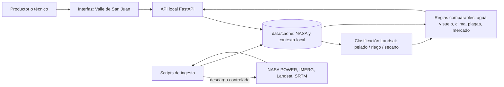

<!-- Actualización asistida por Codex/OpenAI, 2026-11-14; revisión de Frainer pendiente. -->

# 05. Arquitectura mínima

La implementación vigente sigue `docs/10_plan_tecnico.md`: Next.js en `web/`, datos precalculados en `web/public/data/` y ruta Next.js `/api/explain`. No requiere FastAPI ni base de datos; los componentes FastAPI de abajo describen el arranque anterior. Estado real, pruebas y límites en `README.md` y `docs/METHODOLOGY.md`.

## Componentes

- **Interfaz web:** mapa/caso del Valle de San Juan, controles de ubicación aproximada, cultivo previo, riego/secano y prioridad; comparación de escenarios en cuatro pilares.
- **API:** FastAPI sirve métricas, metadatos y resultados derivados precalculados. No debe consultar servicios externos por cada interacción de la demo.
- **Datos y caché:** `data/cache/` mantiene archivos de NASA y otras fuentes públicas con metadatos de fuente, período, descarga, unidad, escala y licencia. Nunca guardar credenciales.
- **Análisis Landsat:** proceso reproducible que produce clases de campo pelado y riego/secano, junto con período, resolución, método, confianza y muestras revisadas. Si no hay entrenamiento/validación suficientes, mostrar como prototipo preliminar.
- **Motor de escenarios:** reglas visibles para comparar línea base y alternativas en agua/suelo, clima, plagas (reglas IDIAF verificadas) y mercado. No predice rendimiento ni brotes.
- **Modo offline:** empaquetar un caso San Juan en caché y permitir que la demo lo muestre sin red. Las descargas son tarea explícita separada.

## API inicial

- `GET /health`: estado del proceso.
- `GET /climate`: clima de demo desde caché, incluyendo producto, coordenada aproximada, período, unidades, resolución y limitaciones.
- `GET /scenarios`: escenarios precalculados y componentes con reglas/fuentes asociadas.

La API sirve primero la caché, sin depender de red en la presentación. Coordenadas se validan y se limitan al área piloto; no registrar ubicación precisa identificable de productores.

## Reglas de calidad de datos

Cada valor expuesto incluye fuente, escala, período, unidad y confianza o estado de calidad. La falta de datos aparece como tal, sin imputación silenciosa. Diferenciar observación satelital, reanálisis, regla agronómica y dato declarado por usuario. LLM explicativo solo como opción secundaria aprobada y citada; sensores fuera de la demo.
