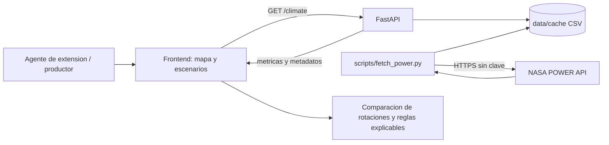

# 05. Arquitectura mínima

## Componentes

- **Frontend:** mapa y controles en navegador; sugerencia React + Leaflet, sin framework decidido todavía.
- **Backend:** Python + FastAPI, endpoints de salud y lectura de clima cacheado.
- **Datos:** `data/cache/` contiene CSV público de NASA POWER para coordenada, parámetros y periodo conocidos. Metadatos en nombre de archivo y documentación. No guardar credenciales.
- **Flujo:** pedir coordenada/periodo, consultar caché; si falta, la descarga se ejecuta como tarea explícita mediante script. La demo debe poder mostrar el CSV sin depender de API externa.

## API inicial

- `GET /health`: estado del proceso.
- `GET /climate`: lee el CSV de demo desde `data/cache/` y devuelve registros y metadatos básicos.

Este esqueleto lee la caché estática; no valida ubicación arbitraria ni consulta NASA en cada petición. Para producción se requerirán validación de parámetros, manejo de errores, límites de respuesta, metadatos de producto y controles de uso.
