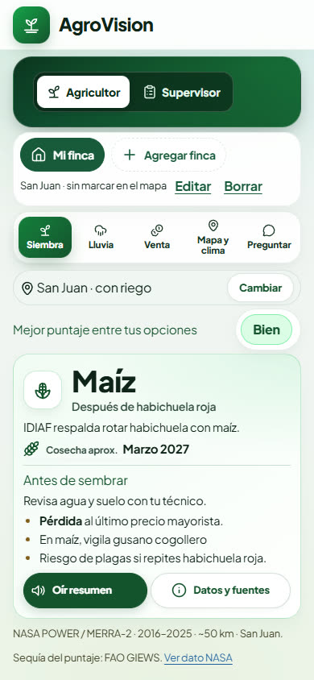
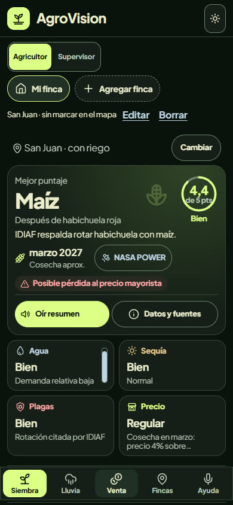
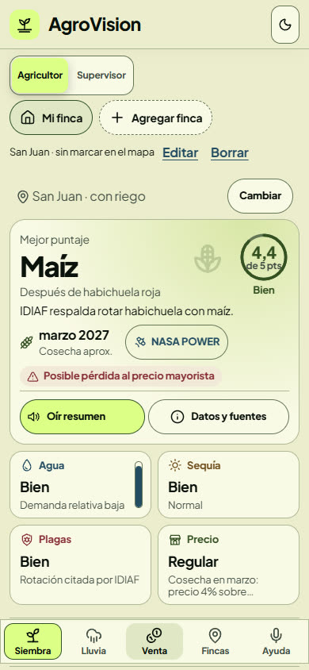

<!-- AI: OpenAI GPT-6, 2026-11-15. Revisión de Frainer pendiente. -->
# Diseño de AgroVision

AgroVision ayuda a comparar qué sembrar y preparar una venta en el campo dominicano. En un teléfono, la decisión de siembra va primero: cultivo, puntaje, motivo, cosecha aproximada y una precaución. Los cuatro pilares aparecen justo debajo. Usa palabras de campo en español y conserva los estados sin datos.

La referencia visual es [TERA — Farm Management SaaS Platform UI/UX Design](https://www.behance.net/gallery/251337883/Farm-Management-SaaS-Platform-UIUX-Design-TERA). Se tomó la jerarquía de la vista móvil, el contraste entre números y etiquetas, la navegación inferior y el uso de color por función. Sus imágenes, tipografía de marca, cifras y diagramas no se incluyen en la aplicación.

| Token | Modo oscuro | Modo sol | Uso |
| --- | --- | --- | --- |
| Lienzo | Ink Green `#0B120D` | Warm Ivory `#EDEDCE` | Fondo general |
| Texto | Warm Ivory `#EDEDCE` | Ink Green `#0B120D` | Lectura y números |
| Acción | Soft Lime `#DDFF86` | Soft Lime `#DDFF86` | Acción principal; texto Ink Green |
| Agua | Light Sky Blue `#BED5E5` | `#244D64` | Lluvia y comparación de agua |
| Riesgo | Soft Coral `#FFA4A4` | `#892F36` | Precauciones |
| Favorable | Soft Lime `#DDFF86` | `#345123` | Estado favorable |
| Superficie | `#151E17` | `#FAF9E7` | Tarjetas y paneles |
| Borde de control | `#6C826E` | `#657658` | Campos y controles interactivos |

Tokens en `web/app/globals.css`: variables semánticas para shadcn y Tailwind 4, separación de 4–24 px, esquinas de 12 px en controles y de 16–20 px en tarjetas. Plus Jakarta Sans variable; el cuerpo parte de 16 px, con etiquetas menores y números tabulares. Movimiento breve de 160–220 ms, con reducción según la preferencia del sistema. La elección de Modo sol queda en el navegador.

- **HeroRecommendation / ScoreRing:** un cultivo y su puntaje comparativo sobre 5. Un valor faltante se explica; el anillo no comunica probabilidad, rendimiento ni una medición.
- **MetricTile / WaterGauge:** un icono, un estado en palabras y una descripción por pilar. La barra de agua representa el puntaje relativo FAO-56. No representa humedad medida en el suelo.
- **RiskPill / SourceChip:** muestran una precaución concreta y acceso a datos. El panel «Datos y fuentes» conserva evidencia, períodos, escalas y límites.
- **BottomNav / ThemeToggle:** cinco pestañas con texto e iconos. En teléfono la barra ocupa una fila fija y reserva espacio para el área segura; en pantallas grandes aparece sobre el contenido. Las flechas recorren las pestañas con teclado.
- **StepProgress / FieldMapCard:** paso actual y total en texto; selección sobre el mapa en lima; resultado separado en gasto, venta y saldo. La barra compara una oferta o el escenario medio con el precio mínimo calculado.
- **Lluvia y voz:** las barras muestran mm con sus etiquetas y acceso al detalle diario. Una copia guardada conserva su antigüedad visible. El orbe usa espacio propio para que su estado no tape los controles.

La referencia incluye gestión de maquinaria, humedad medida e indicadores operativos ilustrativos. AgroVision usa datos regionales y comparaciones con límites comprobables, por eso conserva las unidades, la atribución y las advertencias incluso en pantallas pequeñas.

## Capturas

Mismo flujo de Siembra para una finca de demostración en San Juan:

| Antes | Después (oscuro) | Después (Modo sol) |
| --- | --- | --- |
|  |  |  |

Las pruebas visuales usan una finca de ejemplo y, para el recorrido de Lluvia y Venta, un pronóstico de prueba y cantidades declaradas de prueba. Las capturas ilustran la interfaz.
